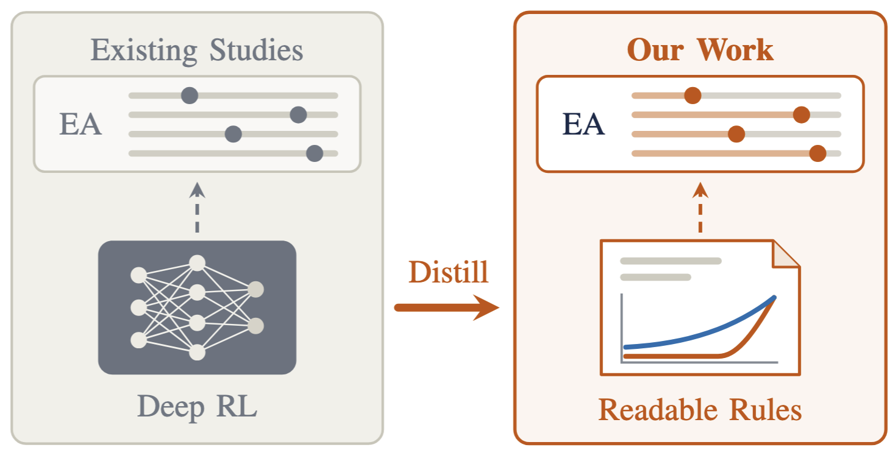
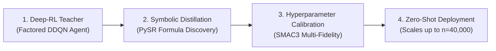

<h1>
    <p align="center"> Discovering Interpretable Multi-Parameter Control Policies for Evolutionary Algorithms Using Deep Reinforcement Learning </p>
</h1>

<p align="center">
    <a href="#-table-of-contents"></a>
    <a href="#-installation"></a>
    <a href="#step-1-find-symbolic-formulas-fit_sr"></a>
    <a href="#step-2-calibrate-constants-tune_formulas"></a>
    <a href="LICENSE"></a>
</p>

> **Turning black-box neural networks into simple, human-readable control formulas.**  
> Evolutionary algorithms rely heavily on parameter settings (such as population sizes and mutation rates), and the optimal values change continuously as the search progresses. While Deep Reinforcement Learning (deep-RL) can learn powerful dynamic control policies, neural networks act as black boxes—theorists cannot analyze neural weights, and practitioners face high deployment overhead. This project demonstrates how deep-RL can serve as an automated *discovery engine*, extracting transparent algebraic formulas that anyone can read, analyze, and execute in $O(1)$ time with **up to 31%–34% fewer evaluations than theoretical baselines**.

---

## 🗒️ Table of Contents

- [Overview & Intuition](#-overview--intuition)
- [Repository Structure](#-repository-structure)
- [Installation](#-installation)
  - [1. Conda Environment & Core Dependencies](#1-conda-environment--core-dependencies)
  - [2. Symbolic Regression (PySR) Backend](#2-symbolic-regression-pysr-backend)
- [How It Works: Step-by-Step](#-how-it-works-step-by-step)
  - [Step 1: Extract Symbolic Formulas (`fit_sr`)](#step-1-extract-symbolic-formulas-fit_sr)
  - [Step 2: Calibrate Formula Constants (`tune_formulas`)](#step-2-calibrate-formula-constants-tune_formulas)
  - [Step 3: Test Generalization & Scale-Up (`test_sr`)](#step-3-test-generalization--scale-up-test_sr)
  - [Optional: Re-extract Trajectories from Raw Logs](#optional-re-extract-trajectories-from-raw-logs)
- [Upstream Deep-RL Oracles](#-upstream-deep-rl-oracles)
- [License](#-license)

---

## 💡 Overview & Intuition

<p align="center">
  
</p>

### The Core Idea: Distilling Neural Policies into Transparent Math

In the $(1+(\lambda,\lambda))$-GA optimizing the OneMax benchmark, four parameters are dynamically controlled based on current solution fitness progress $u = f(x)/n \in [0, 1)$:

| Parameter | Meaning | Practical Intuition |
| :--- | :--- | :--- |
| $\lambda_m$ | **Mutation Offspring** | How many mutated candidate solutions to generate each round |
| $\alpha$ | **Mutation Rate Scaling** | How aggressively bits are flipped ($p = \alpha \lambda_m / n$) |
| $\lambda_c$ | **Crossover Offspring** | How many crossover solutions to build to repair mutations |
| $\beta$ | **Crossover Bias** | How strongly offspring inherit from the parent vs. mutant ($c = \beta / \lambda_c$) |

Rather than keeping the learned policy locked inside a neural network, our pipeline translates agent decisions into simple algebraic formulas:



### Key Takeaways from the Discovered Rules

1. **A Shared Rational Scaling Law**: Symbolic regression discovers that both population sizes ($\lambda_m$ and $\lambda_c$) naturally follow a rational schedule:
   $$\text{Population}(u) \approx \frac{a}{b - u}$$
   When far from the optimum ($u < 0.9$), small populations conserve function evaluations. As the search approaches the optimum ($u \to 1$), population sizes surge to break through the final plateaus.
2. **Offspring Polarization**: Optimal search efficiency requires keeping mutation lean ($\lambda_m = 1$) early on to prevent wasted evaluations, while aggressively expanding crossover capacity ($\lambda_c > 500$) near the optimum to accelerate genetic repair.
3. **Zero-Shot Scale-Invariance**: Because mathematical operators are dimension-independent, formulas tuned on small sizes ($n \le 2{,}000$) seamlessly generalize to huge problem dimensions (tested up to $n = 40{,}000$) with zero retraining.

---

## 🎯 Repository Structure

```plaintext
OneMax-MPDAC/
├── assets/                             # Visual diagrams and figures
│   └── xdac.png                        # Framework architecture diagram
├── notebooks/
│   └── test.ipynb                      # Interactive notebook to test trained models
├── resources/
│   ├── ddqn_ckpts/                     # Pre-trained Factored DDQN weights
│   ├── exps/                           # Raw evaluation logs from training runs
│   ├── trajectories/                   # Extracted state-action datasets (pkl)
│   └── runtimes/                       # Pre-computed baseline benchmark data
├── dacbench/                           # Extended DACBench benchmark suite
├── xdac/                               # Main Python implementation
│   ├── fit_sr.py                       # Step 1: Symbolic regression fitting via PySR
│   ├── tune_formulas.py                # Step 2: Continuous formula tuning via SMAC3
│   ├── test_sr.py                      # Step 3: Scale-up testing & parameter ablation
│   ├── extract_trajectories.py         # Helper: Extract best trajectories from logs
│   ├── fact_ddqn.py                    # Factored DDQN model architecture
│   ├── comb_ddqn.py                    # Combinatorial DDQN model architecture
│   ├── train_ddqn.py                   # Deep-RL DDQN training script
│   ├── train_fact_ppo.py               # Deep-RL PPO training script
│   └── utils.py                        # Common helper utilities
├── scripts/                            # Ready-to-run shell scripts
│   ├── fit_sr.sh                       # Runs PySR symbolic regression
│   ├── tune_formulas.sh                # Runs SMAC3 hyperparameter tuning
│   ├── test_sr.sh                      # Runs scale-up evaluation suite
│   └── run.sh                          # Sample experiment execution script
├── requirements.txt
└── README.md
```

---

## ⚙️ Installation

### 1. Conda Environment & Core Dependencies

Create and activate a clean Python 3.10 environment:

```bash
conda create -n onemaxmpdac python=3.10 -y
conda activate onemaxmpdac
```

Install PyTorch suited to your hardware:

```bash
# CPU only (recommended for symbolic regression & tuning):
pip install torch torchvision --index-url https://download.pytorch.org/whl/cpu

# Or for CUDA GPU support:
pip install torch torchvision --index-url https://download.pytorch.org/whl/cu118
```

Install the remaining dependencies:

```bash
pip install -r requirements.txt
```

### 2. Symbolic Regression (PySR) Backend

PySR connects Python to the high-performance Julia library `SymbolicRegression.jl`.

> [!TIP]
> In shared HPC or university clusters where Conda paths might be read-only, ensure Julia packages install to your home directory:

```bash
export PYTHON_JULIAPKG_PROJECT="$HOME/.julia_env"
```

Initialize and precompile Julia once (takes ~1–2 minutes, subsequent runs load instantly):

```bash
python -c "import pysr"
```

---

## 🔬 How It Works: Step-by-Step

### Step 1: Extract Symbolic Formulas (`fit_sr`)

Stage I uses Genetic Programming (`PySR`) to find concise algebraic equations that reproduce the actions taken by the best Deep-RL agents across normalized fitness $u = f(x)/n \in [0.5, 1.0)$.

#### Discovered Formula Shapes

- **$\lambda_m(u)$ (Mutation Size)**: $\lambda_m(u) = \frac{a_m}{b_m - u}$ (reserves large mutations exclusively for the final sprint).
- **$\alpha(u)$ (Mutation Rate)**: $\alpha(u) = a_\alpha u^2 + b_\alpha u + c_\alpha$ (a gentle U-profile that dips mid-search so crossover can recombine solutions undisturbed).
- **$\lambda_c(u)$ (Crossover Size)**: $\lambda_c(u) = \frac{a_c}{b_c - u}$ (scales aggressively to supply genetic repair candidates).
- **$\beta(u)$ (Crossover Bias)**: Stays near constant $\approx 1.0$ (showing that varying crossover bias provides little algorithmic benefit).

#### How to Run

Use [`scripts/fit_sr.sh`](scripts/fit_sr.sh) or [`xdac/fit_sr.py`](xdac/fit_sr.py):

```bash
# Fit all 4 parameters sequentially (lbd_m, alpha, lbd_c, beta)
./scripts/fit_sr.sh

# Or fit an individual parameter (0: lbd_m, 1: alpha, 2: lbd_c, 3: beta)
./scripts/fit_sr.sh 0

# Customize CPU cores or iterations if desired
NCPUS=16 NITERATIONS=5000 ./scripts/fit_sr.sh 0
```

Direct Python command:
```bash
python xdac/fit_sr.py --target 0 --ncpus 16 --niterations 5000 --out-dir outputs
```

Results are saved to `outputs/<date>/<time>/`, including raw Pareto front CSVs, selected formula summaries, and fit plots.

---

### Step 2: Calibrate Formula Constants (`tune_formulas`)

Formulas extracted from discrete-action networks can inherit slight rounding or quantization artifacts. Stage II calibrates the continuous numbers in the formulas directly against total solution evaluations using SMAC3 Multi-Fidelity Hyperband.

#### Two Policy Styles

You can tune either of two architectures:

1. **`e2e_policy` (End-to-End, 10 parameters)**: Purely machine-discovered formulas for all four parameters.
2. **`co_design_policy` (Co-Design, 7 parameters)**: The top performer overall. Pairs machine-discovered rational scaling with domain-expert thresholds (e.g. keeping $\lambda_m = 1$ during early exploration, then switching to the rational curve near the optimum).

#### How to Run

Use [`scripts/tune_formulas.sh`](scripts/tune_formulas.sh) or [`xdac/tune_formulas.py`](xdac/tune_formulas.py):

```bash
# Tune both e2e_policy and co_design_policy sequentially
./scripts/tune_formulas.sh

# Tune co_design_policy only using 32 worker CPUs
./scripts/tune_formulas.sh co_design_policy --total-cpus 32

# Parameter ablation: optimize only alpha, lbd_c, and beta while fixing lbd_m
./scripts/tune_formulas.sh e2e_policy --combine alpha lbd_c beta
```

Direct Python command:
```bash
python xdac/tune_formulas.py \
    --policy co_design_policy \
    --problem-sizes 100 200 500 1000 1500 2000 \
    --total-cpus 32 \
    --out-dir outputs
```

Outputs are saved under `outputs/tune_default/<policy>/<timestamp>/` with:
- `incumbent_<policy>.json`: Optimal parameter constants.
- `summary.json`: Detailed validation comparison between default anchors and tuned results.

---

### Step 3: Test Generalization & Scale-Up (`test_sr`)

Test how well the resulting policies perform across problem sizes from $n = 100$ up to $n = 40{,}000$ using a high-speed vectorized OneMax simulation (`FastOneMax`).

#### Performance Highlights

- **Up to 31%–34% faster than standard theoretical baselines** ($\pi_{\text{THEORY}}$).
- **Outperforms IRACE-tuned static parameters and handcrafted heuristics**.
- **Evaluates in $O(1)$ time per step** with no neural network inferences.

#### How to Run

Use [`scripts/test_sr.sh`](scripts/test_sr.sh) or [`xdac/test_sr.py`](xdac/test_sr.py):

```bash
# Evaluate co_design_policy across all benchmark sizes up to n=40,000
./scripts/test_sr.sh --policy co_design_policy

# Evaluate e2e_policy
./scripts/test_sr.sh --policy e2e_policy

# Evaluate the handcrafted baseline for comparison
./scripts/test_sr.sh --policy handcrafted_policy

# Run ablation: see how performance changes if lbd_m is turned off
./scripts/test_sr.sh --policy e2e_policy --combine alpha lbd_c beta

# Quick debugging run on small sizes with fewer runs
./scripts/test_sr.sh -p co_design_policy -n 100 500 --n-reps 50 --n-cpus 8
```

Direct Python command:
```bash
python xdac/test_sr.py \
    --policy co_design_policy \
    --problem-sizes 100 500 2000 3000 4000 5000 10000 20000 30000 40000 \
    --n-reps 1000 \
    --total-cpus 64 \
    --out-dir outputs
```

---

### Optional: Re-extract Trajectories from Raw Logs

The pre-extracted trajectory dataset is already provided in [`resources/trajectories/best_ddqn_policies_n100_2000.pkl`](resources/trajectories/best_ddqn_policies_n100_2000.pkl). 

If you retrain your own DDQN models and wish to re-extract the best trajectories across all runs, simply run:

```bash
python xdac/extract_trajectories.py
```

This scans `resources/exps/`, finds the runs with the lowest Expected Running Time (ERT) for each dimension $n$, and writes the consolidated pickle file.

---

## 🤖 Upstream Deep-RL Oracles

For researchers interested in inspecting or retraining the neural agents that served as the teacher models:

### Pre-trained Model Checkpoints
Pre-trained Factored DDQN weights across $n \in \{100, 200, 500, 1000, 1500, 2000\}$ are stored in `resources/ddqn_ckpts/`. You can load and test them interactively via [`notebooks/test.ipynb`](notebooks/test.ipynb).

### Training Neural Agents

```bash
# Train Factored DDQN (n=100)
python xdac/train_ddqn.py \
    --config-file xdac/configs/onemax_n100_fmp_as.yml \
    --gamma 0.9998 \
    --seed 1 \
    --out-dir outputs \
    --n-cpus 4

# Train Factored PPO (n=100)
python xdac/train_fact_ppo.py \
    --setting-file xdac/configs/onemax_n100_mp_ppo.yml \
    --seed 1 \
    --out-dir outputs \
    --n-cpus 4
```

---

## 📄 License

This repository is licensed under the [MIT License](LICENSE).
